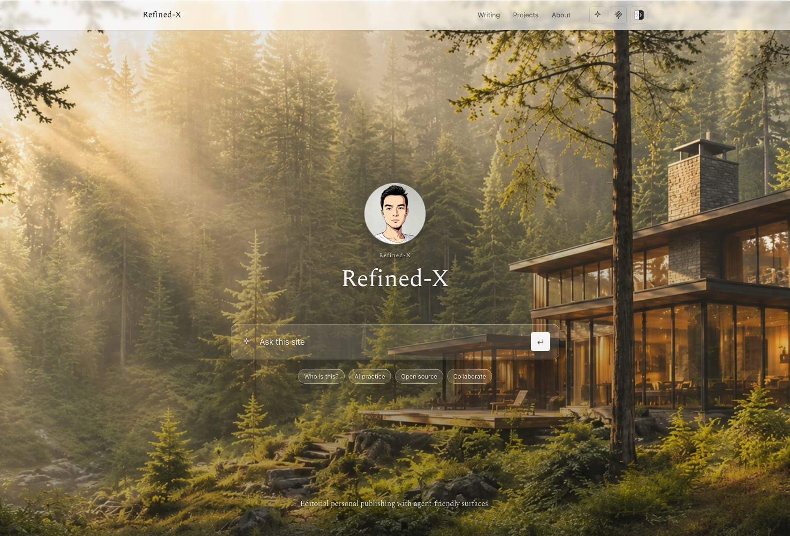
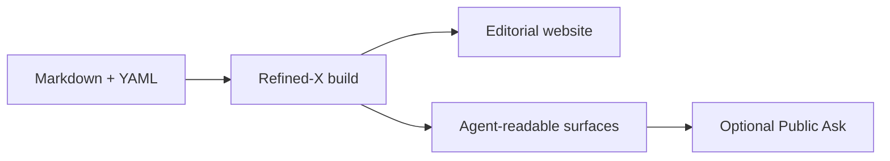

English | [简体中文](README.zh-CN.md)

# Refined-X

## Your public interface for the agentic web

Publish once for people, search engines, and AI agents.

Refined-X is an opinionated personal publishing starter built with
[Astro](https://astro.build/) and [Starlight](https://starlight.astro.build/).
Write in Markdown and YAML; Refined-X turns the same public corpus into:

- a calm, editorial website for human readers;
- Markdown mirrors, `llms.txt`, and structured JSON for language models;
- OpenAPI and MCP discovery metadata for programmatic clients;
- an optional NLWeb-compatible Ask service for live, grounded Q&A.

Your content stays in your own repository or knowledge vault. The site is
static by default, and the AI service is optional.

[Live demo](https://demo.refined-x.com) ·
[Ask the demo](https://demo.refined-x.com/ask/) ·
[Use this template](https://github.com/new?template_name=Refined-X&template_owner=tower1229) ·
[Production example](https://refined-x.com)



## Why Refined-X?

Most personal sites publish HTML and stop there. That works for browsers, but
agents must still extract meaning from navigation, layout, and scripts.

Refined-X publishes one source corpus through three surfaces:

| Surface          | What it provides                                                        |
| ---------------- | ----------------------------------------------------------------------- |
| Human-readable   | Articles, series, projects, profile, answers, topics, light/dark themes |
| Machine-readable | Per-page Markdown, `llms.txt`, `llms-full.txt`, JSON APIs, OpenAPI      |
| Agent-queryable  | Static curated search, optional NLWeb `/ask`, optional MCP `ask` tool   |



## What makes it different

### One corpus, multiple outputs

Articles, answers, projects, series, and public profile data share an explicit
content schema. Refined-X generates the website and every machine-readable
surface from that same source of truth.

### Content independent from the theme

`contentRoot`, `publicDir`, and `outDir` are configurable. Keep a personal
vault or monorepo outside the template, and use Refined-X only as the publishing
layer.

### Useful without an AI backend

The default site is fully static. `/ask` searches curated answers and public
articles without a model, database, or runtime bill.

### Live Q&A when you want it

The optional Public Ask Worker adds grounded retrieval and summarization through
a restricted NLWeb v0.55-compatible `/ask` endpoint and a dual-era Streamable HTTP MCP
server (one `ask` tool on `/mcp` for modern `2026-07-28` and legacy 2025 clients).
Offline dual-era integration runs in CI; product-client verification is recorded in
[`docs/mcp-client-support-matrix.md`](docs/mcp-client-support-matrix.md) (core: Claude Code modern + Codex CLI legacy on a synthetic mock backend; other clients stay `not_run`).
It includes quotas, rate limits, browser verification, source links,
and explicit capability boundaries.

### Designed for reading

Agent support is not allowed to turn the site into a dashboard. Refined-X keeps
an editorial, monochrome visual system with restrained motion and accessible
light/dark themes.

## Quick start

This repository is a GitHub template. Select
[Use this template](https://github.com/new?template_name=Refined-X&template_owner=tower1229),
or run:

```sh
npm create astro@latest -- --template tower1229/Refined-X
cd <project>
npm install
npm run dev
```

Then open the local URL printed by Astro.

Before deploying:

```sh
npm run check
npm run test:public-ask
npm run test:related
npm run build
npm run verify
```

## Choose a deployment mode

| Mode                    | Infrastructure                                              | Result                                                                             |
| ----------------------- | ----------------------------------------------------------- | ---------------------------------------------------------------------------------- |
| Static                  | GitHub Pages, Cloudflare Pages, Netlify, or any static host | Website, local Ask search, Markdown, `llms.txt`, JSON, OpenAPI, discovery metadata |
| Static + external vault | Static host plus an external `contentRoot`                  | Same outputs while content remains outside the template                            |
| Live Ask                | Static site plus the reference Cloudflare Worker            | Grounded browser answers, NLWeb `/ask`, MCP `ask`, health endpoint                 |

Start static. Add Live Ask only when conversational access is useful.

## Deploy static site

| Path | Guide |
| ---- | ----- |
| GitHub Pages | Copy [`deploy/user-github-pages.yml`](deploy/user-github-pages.yml) → enable Pages (GitHub Actions) |
| Cloudflare Pages | Build `npm run build`, output `dist`, Node `24` |

Step-by-step: [`docs/deploy-static.md`](docs/deploy-static.md).

Cloudflare Pages: connect the repo in the [dashboard](https://dash.cloudflare.com/) ([git integration docs](https://developers.cloudflare.com/pages/get-started/git-integration/)). GitHub Pages: copy the workflow linked above.

## Content model

The default public corpus lives in `content/`:

```text
content/
  articles/**/*.md
  answers/**/*.md
  pages/**/*.md
  profile/
    person.yaml
    cooperation.yaml
    resume.md
  projects/*.{yaml,yml,json}
  series/
    series.json
    *.yaml
```

Article frontmatter is intentionally explicit:

```yaml
---
title: Building for humans and agents
description: A short description for readers and search engines.
contentType: article
pubDate: 2026-07-01
slug: humans-and-agents
series: notes
tags:
  - publishing
  - agents
llmSummary: A concise, evidence-grounded summary for machine-readable outputs.
---
```

The schema validates required dates, slugs, summaries, answer fields, and
content types during the build.

Optional `seoTitle` overrides browser and sharing titles without changing the article H1.
Use `seoImage` for a deliberate sharing image and `updatedDate` for actual content changes;
the latter must not precede `pubDate`.

With `assetSource` configured, asset collection preserves original URLs and generates
content-addressed WebP variants and dimensions. Markdown images use this manifest for
responsive sources and lazy loading. GIF, animated images, and SVG retain their format.
JPEG candidates use dimensions after EXIF orientation, so width descriptors are unique
and reflect the encoded pixels. Image cache v3 includes platform, architecture, and Sharp/native-codec versions; it bypasses older caches after encoder upgrades.
List previously public originals in `retainedAssets` when retiring content so a clean
checkout can still rebuild those URLs. Spectral Latin subsets are self-hosted; their
license is in `src/assets/fonts/Spectral-OFL.txt`.

Before cleanup, collection rejects source/output overlap (including symlinks) and protects declared content and history inputs from deletion. A content root may contain the public directory, but cannot reside inside the generated asset directory.

Each collection rebuilds the generated asset directory; public and dist preview leftovers
are not history. Set `REFINED_X_ASSET_HISTORY` to an explicit publication snapshot to retain
old derived URLs. Its `asset-history.json` declares `version: 1`, `sourceRevision`, and
`files: [{ file, sha256 }]`; blobs reside in `optimized/` and are verified before restoration.
Hosting adapters obtain snapshots from pushed artifacts, separately from build caches.

Maintain `feedUpdatedDate` and `pageUpdatedDates` when feed, listing, or static-page content
changes cannot be represented by article dates alone. Never refresh them merely because
a build ran. Collections, including archive pagination, use the newer of their computed
member date and authored date. RSS discovery is available in the shared head and the footer.

Run `npm run test:site` for image, link, deployment-base, and date regressions, then
`npm run verify` against the built output. Hosting adapters can pass `resolveRoute` to
`auditSite` in `scripts/site-audit.mjs` to check deployment redirects before filesystem
fallback. Inline CSS static URLs and data-src resources are checked as well. Hosting
adapters maintain concrete examples for historical dynamic routes. Length heuristics and empty ALT are editorial warnings, not fixed SEO limits.
Metadata names and canonical relation tokens are compared case-insensitively, including copied legacy HTML.

Pagefind output uses its pinned public `getFiles()` API followed by awaited Node writes
and SHA-256 readback. Both `build` and `verify` reject empty or malformed entries,
missing language metadata/WASM, invalid compressed payloads, and missing or changed
bundle files. Deploy the entire `pagefind/` directory, including `refined-x-manifest.json`.
The built-in Ask UI still searches `/api/search-index.json`; Pagefind is a separate
static index for integrations. `npm run test:search` exercises 100 real native exports;
`npm run test:search-build` injects corrupt artifacts into actual Astro builds and
checks both gates. See [search integrity notes](docs/pagefind-integrity.md) for the
failure diagnosis and validation limits. The memory export temporarily holds the
whole search bundle in RAM; large sites should measure build memory before upgrading.

## Configure your site

Security maintenance: v2.1.1 updates both the site and optional Worker lockfiles.
Run `npm ci` separately in this directory and `examples/public-ask-worker`, then
run `npm audit` in each; CI audits production and development dependencies at all
severity levels. Registry availability and newly disclosed advisories can fail that gate.
The Worker pins MCP SDK 2.3.0 and Wrangler 4.153.0; regenerate Worker types and run
the offline protocol suite before updating an instance. Updating the template does
not deploy an existing Worker. See [security upgrade notes](docs/security-upgrade-2026-10-29.md)
for exact versions, advisory sources and acceptance boundaries.

For most installations, create an `instance.config.mjs` overlay. You can also
edit the defaults in [`site.config.mjs`](site.config.mjs):

```js
export default {
  site: "https://example.com",
  title: "Your Name",
  locale: "en",
  timeZone: "UTC",
  contentRoot: "./content",
  publicDir: "./public",
  outDir: "./dist",
  brand: {
    persona: "Your Name",
    homeHeading: "Your Name",
    homeLede: "What you publish and why it matters.",
  },
};
```

Common options:

| Field         | Default     | Purpose                                   |
| ------------- | ----------- | ----------------------------------------- |
| `locale`      | `en`        | UI language pack: `en` or `zh-CN`         |
| `contentRoot` | `./content` | Public Markdown/YAML corpus               |
| `publicDir`   | `./public`  | Static assets                             |
| `outDir`      | `./dist`    | Build output                              |
| `assetSource` | unset       | Optional external image library           |
| `brand.*`     | demo values | Public identity and home-page copy        |
| `ask.*`       | empty       | Optional Public Ask / MCP / health URLs; `protocolProfile` defaults to `undeclared` (set `dual-era` only after deployment acceptance) |
| `discovery.awp` | `false`   | Optional AWP 0.2 manifests; when `true`, emits byte-identical `/agent.json` and `/.well-known/agent.json` (phase-1 static reads only); llms does not auto-recommend them; subpath deploy limits — see plan §8.3 |
| `comments.*`  | empty       | Optional giscus repository and category   |

Relative paths resolve from the Refined-X package root.

## Enable article comments

Refined-X can load [giscus](https://giscus.app/) on article pages and keep the
discussion data in a public GitHub Discussions repository. Enable Discussions,
install the giscus GitHub App, create a discussion category, then copy the four
public identifiers from the giscus configuration page:

```js
export default {
  comments: {
    repo: "owner/repository",
    repoId: "R_...",
    category: "Comments",
    categoryId: "DIC_...",
  },
};
```

Leave all four fields empty to disable comments. A partial configuration fails
the build instead of silently publishing a broken surface. Refined-X uses a
stable `article:<entry.id>` discussion key, follows the site locale and theme,
and loads the third-party iframe lazily. Visitors need a GitHub account to
participate.

## Agent-readable surfaces

Every build exposes a predictable public interface:

| Endpoint                            | Purpose                                         |
| ----------------------------------- | ----------------------------------------------- |
| `/llms.txt`                         | Compact site map and important links for agents |
| `/llms-full.txt`                    | Full public text corpus                         |
| `/<page>.md`                        | Clean Markdown mirror of a public page          |
| `/api/profile.json`                 | Structured public identity                      |
| `/api/articles.json`                | Article catalog                                 |
| `/api/topics.json`                  | Topic catalog                                   |
| `/api/search-index.json`            | Static Ask/search corpus                        |
| `/openapi.json`                     | API and optional Ask/MCP contract (only declares configured remotes) |
| `/.well-known/about.json`           | Site capability summary                         |

These endpoints make the site easier to ingest and connect. They do not assume
that every agent automatically discovers or invokes them.

Legacy draft MCP discovery paths (`/.well-known/mcp.json`,
`/.well-known/mcp/catalog.json`, `/.well-known/mcp/server-card.json`) were
**removed** in a breaking change. Prefer the configured MCP endpoint URL,
OpenAPI, and `about.json`. Do not expect `/.well-known/ai-catalog.json`.

## Enable Live Ask

Optional Cloudflare Worker for grounded browser answers, NLWeb `POST /ask`, and
MCP `ask`. Package: [`examples/public-ask-worker`](examples/public-ask-worker).

**Deploy checklist and troubleshooting:** [`docs/deploy-live-ask.md`](docs/deploy-live-ask.md).

After the Worker is up, point the static site at it:

```js
export default {
  ask: {
    askUrl: "https://ask.example.com/ask",
    mcpUrl: "https://ask.example.com/mcp",
    healthUrl: "https://ask.example.com/health",
    // Optional. Default undeclared — do not claim modern dual-era until accepted.
    // protocolProfile: "dual-era",
  },
};
```

Set `PUBLIC_TURNSTILE_SITE_KEY` at Astro build time when using browser generation.
The hosted demo uses `https://ask-demo.refined-x.com/mcp`.

Live Ask intentionally does not support long-term memory, arbitrary actions,
elicitation, or impersonating the site owner.

## Use an external vault

Refined-X can live as a submodule inside a personal data repository:

```sh
git submodule add git@github.com:tower1229/Refined-X.git 90_Website/Template
```

Place `instance.config.mjs` next to the submodule, or set
`REFINED_X_INSTANCE_CONFIG`:

```js
export default {
  contentRoot: "../../20_Publish",
  publicDir: "../../30_Assets/Public",
  outDir: "../../dist",
};
```

Instance-specific settings stay outside the template, so upstream updates do
not overwrite your identity or content.

## Design

See [`DESIGN.md`](DESIGN.md) for the visual system, typography, component
rules, motion boundaries, and accessibility guidance.


## Scope

Refined-X is:

- a static-first personal publishing starter;
- an opinionated public content schema;
- a reference implementation for agent-readable and agent-queryable surfaces.

Refined-X is not:

- a hosted CMS;
- a private personal agent;
- a long-term memory service;
- a promise of automatic MCP discovery in every client;
- a claim that every MCP client in the extended matrix has been product-verified (see [`docs/mcp-client-support-matrix.md`](docs/mcp-client-support-matrix.md)).

## Contributing

Issues, implementation reports, documentation improvements, and pull requests
are welcome. If you launch a site with Refined-X, open a showcase issue so it
can be included in the community gallery.

- [Contributing guide](CONTRIBUTING.md)
- [Changelog](CHANGELOG.md)
- [Security policy](SECURITY.md)
- [Roadmap](ROADMAP.md)

## License

[MIT](LICENSE)
